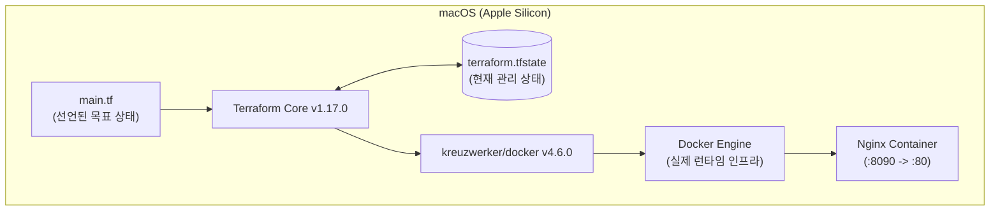

# Terraform IaC & Drift Detection PoC

Docker 컨테이너를 가상 인프라 자원으로 활용하여 **Terraform의 선언적 인프라 관리(IaC)** 및 **인프라 드리프트(Drift) 감지 및 복구** 과정을 검증하는 프로젝트입니다.

---

## 📌 주요 특징
- **비용 0원**: AWS 등 클라우드 프로바이더 과금 없이 로컬 Docker Engine을 인프라로 사용
- **신뢰성 있는 드리프트 감지**: 외부에서 강제 삭제된 컨테이너를 `terraform plan`으로 감지
- **안전한 복구**: 사전에 계획된 플랜 파일(`drift.tfplan`)을 기반으로 동일 스펙 복구

---

## 🛠 아키텍처 개요



---

## 🚀 빠른 시작 가이드

### 1. 사전 요구사항
- macOS (Apple Silicon / Intel Mac, zsh 터미널)
- [Docker Desktop](https://www.docker.com/products/docker-desktop/) 실행 중
- [Terraform](https://developer.hashicorp.com/terraform) v1.5.0 이상

### 2. 실행 명령어

```zsh
# 1. 플러그인 초기화 및 프로바이더 설치
terraform init

# 2. 코드 문법 및 포맷 검증
terraform fmt
terraform validate

# 3. 인프라 생성 계획 확인
terraform plan

# 4. 인프라 배포
terraform apply -auto-approve

# 5. 실행 중인 컨테이너 확인
terraform state list
curl -i http://localhost:8090/
```

### 3. 드리프트 감지 및 복구 테스트

```zsh
# 삭제 전 컨테이너 ID 기록
terraform output -raw container_id > docs/container-before.txt

# 외부(Docker CLI)에서 직접 강제 삭제 (Drift 유발)
docker rm -f terraform-drift-web

# 드리프트 감지 및 계획 저장
terraform plan -out=drift.tfplan -no-color | tee docs/drift-plan.log

# 복구 실행
terraform apply -no-color drift.tfplan | tee docs/recovery.log

# 복구 후 컨테이너 ID 기록 및 비교
terraform output -raw container_id > docs/container-after.txt
diff docs/container-before.txt docs/container-after.txt

# 최종 상태 일치 확인
terraform plan -detailed-exitcode -no-color
```

---

## 📂 프로젝트 구조

```text
cloud-terraform-drift/
├── main.tf                 # Terraform Provider 및 Docker 리소스 정의
├── outputs.tf              # 출력 변수 (URL, Container ID)
├── .gitignore              # tfstate, plan 파일 등 제외 규칙
├── .terraform.lock.hcl     # Provider 의존성 잠금 파일
├── README.md               # 프로젝트 안내서
└── docs/
    ├── ARCHITECTURE.md     # 아키텍처 및 5W1H 상세 설명
    ├── results.md          # 검증 결과 보고서
    ├── DEV_LOG.md          # 개발 작업 일지
    ├── TEST_LOG.md         # 테스트 및 검증 로그
    ├── ERROR_LOG.md        # 트러블슈팅 일지
    ├── container-before.txt# 드리프트 전 컨테이너 ID
    ├── container-after.txt # 드리프트 복구 후 컨테이너 ID
    ├── drift-plan.log      # 드리프트 감지 로그
    └── recovery.log        # 복구 실행 로그
```

---

## 🧹 자원 정리 (Destroy)

```zsh
terraform destroy -auto-approve
```
