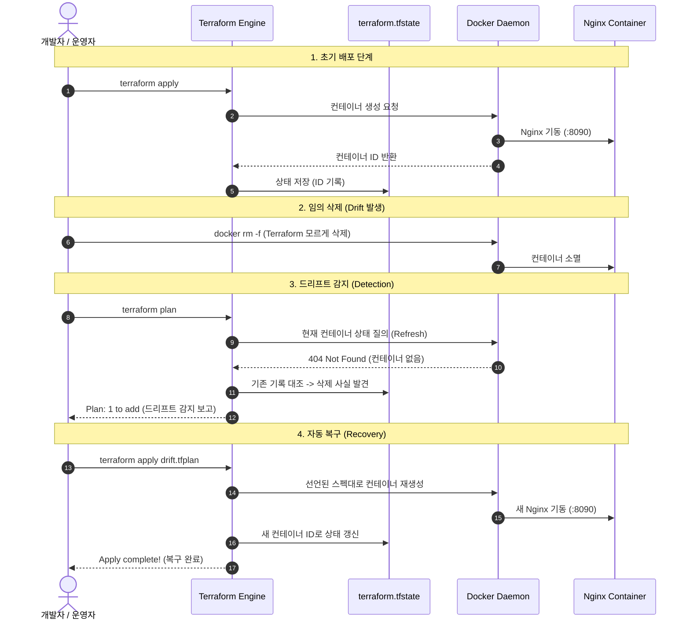

# Terraform IaC & Drift Detection 아키텍처 및 원리 해설

이 문서는 입문자가 Terraform의 기본 원리와 드리프트 감지 메커니즘을 쉽게 이해할 수 있도록 **일상 비유**, **기술적 원리**, **5W1H 체계**로 설명합니다.

---

## 1. 핵심 개념: 일상 비유 → 기술적 원리 → 실무 예시

### 1.1 IaC (Infrastructure as Code)
- **일상 비유**: 요리 레시피북. 말이나 손짓으로 그때그때 요리하지 않고, 재료와 순서가 적힌 레시피를 보며 언제 만들어도 항상 똑같은 맛을 내는 것과 같습니다.
- **기술적 작동 원리**: 클라우드 콘솔 버튼 클릭 대신, HCL(HashiCorp Configuration Language)이라는 선언형 언어 파일(`.tf`)로 인프라의 형태를 정의합니다. 도구가 코드를 읽고 API를 호출하여 해당 인프라를 프로비저닝합니다.
- **실무 예시**: 개발/스테이징/운영 환경 서버 100대를 클릭 없이 코드 복사만으로 5분 만에 오차 없이 배포.

### 1.2 Terraform State (`terraform.tfstate`)
- **일상 비유**: 부동산 등기부 등본. 현실 세계의 실제 건물과 소유주 목록이 장부에 적혀 있어 일치 여부를 대조할 수 있는 기준 문서입니다.
- **기술적 작동 원리**: Terraform이 프로비저닝한 실제 리소스의 ID, IP, 설정 속성들을 JSON 형태로 로컬 또는 원격 스토리지(S3 등)에 저장해 두는 원천 데이터(Source of Truth)입니다.
- **실무 예시**: 팀원들과 협업할 때 S3 + DynamoDB를 통해 State Lock을 걸고 인프라 변경 충돌을 방지.

### 1.3 인프라 드리프트 (Infrastructure Drift)
- **일상 비유**: 집주인 몰래 세입자가 벽지를 바꾼 상황. 원래 설계도와 실제 집의 상태가 달라진 불일치 현상입니다.
- **기술적 작동 원리**: Terraform 코드를 거치지 않고 AWS 콘솔이나 Docker CLI 등 외부에서 리소스가 수정/삭제되었을 때, `terraform plan` 시 실제 인프라의 최신 상태를 API로 읽어와 State 및 코드와 대조하여 감지합니다.
- **실무 예시**: 긴급 장애 대응 중 콘솔에서 수동 수정한 방화벽 인바운드 룰이 다음 Terraform 배포 시 감지되거나 덮어씌워지는 현상.

---

## 2. 5W1H (육하원칙) 기반 분석

| 질문 | 내용 |
| :--- | :--- |
| **What (무엇인가?)** | 선언적 코드로 인프라를 관리하고, 외부 변경(Drift)을 자동으로 대조·감지하여 복구하는 IaC 파이프라인 |
| **Why (왜 필요한가?)** | 사람이 수동으로 인프라를 관리할 때 발생하는 실수(Human Error)를 막고, 인프라의 현재 상태를 항상 코드와 100% 일치시키기 위해 |
| **When (언제 사용하는가?)** | 서버/네트워크 생성, 변경 계획 수립 시, 그리고 누군가 수동 변경했는지 주기적으로 점검할 때 |
| **Where (어디에 적용되는가?)** | `cloud-terraform-drift/main.tf`, `outputs.tf`, 로컬 Docker 데몬 소켓(`/var/run/docker.sock`) |
| **Who (누가 담당하는가?)** | `Terraform Core` 엔진과 `kreuzwerker/docker` 프로바이더 플러그인 |
| **How (어떻게 작동하는가?)** | Refresh(실제 상태 조회) → Diff(코드 vs 실제 비교) → Plan(차이점 계산) → Apply(API 호출하여 일치시킴) |

---

## 3. 드리프트 감지 및 복구 시퀀스 다이어그램

---

## 4. 공식 문서 참조
- [HashiCorp Terraform 공식 문서](https://developer.hashicorp.com/terraform)
- [Kreuzwerker Docker Provider 공식 문서](https://registry.terraform.io/providers/kreuzwerker/docker/latest/docs)
